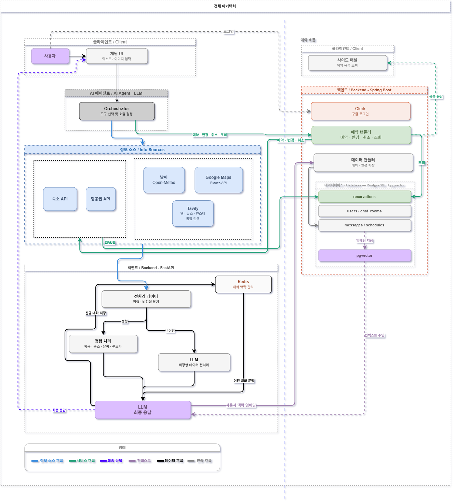
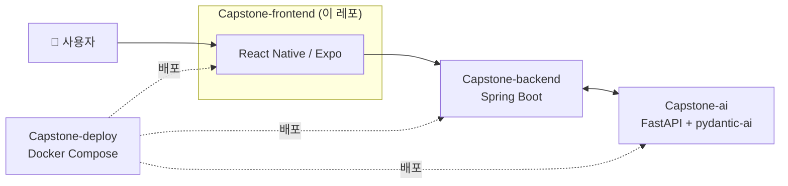

# 🚀 마실 (Masil) — Frontend

> **대화형 실시간 정보 기반 여행 일정 생성 및 예약 서비스**

**마실**은 정적이고 파편화된 기존 여행 정보 서비스의 한계와 생성형 AI의 환각(Hallucination) 문제를 극복하기 위한 서비스입니다. 실시간 데이터를 동적으로 결합해 신뢰할 수 있는 여행 가이드를 제공하고, 정보 탐색부터 일정 계획, 실제 예약까지 하나의 대화형 인터페이스 안에서 끝맺는 것을 목표로 합니다.

이 레포는 마실의 4개 서비스 중 **모바일 프론트엔드**로, **React Native (Expo)** 기반으로 구축되었습니다.



<!-- TODO: 앱 스크린샷은 별도로 docs/images/screenshots.png 에 저장 후 아래 주석 해제 (앱 런타임 리소스인 assets/와는 별도)

-->

---

## 👥 팀 (4조 · 여울)

명지대학교 컴퓨터공학전공 캡스톤디자인 (지도교수: 안희철)

| | 역할 | 이름 | GitHub |
| :---: | :--- | :--- | :--- |
|  | 팀장 | 박지후 | [@thisisjihoo](https://github.com/thisisjihoo) |
|  | 팀원 | 임채현 | [@Chaehyunli](https://github.com/Chaehyunli) |
|  | 팀원 | 김한슬 | [@hanseul377](https://github.com/hanseul377) |
|  | 팀원 | 남서현 | [@DOOYEE0709](https://github.com/DOOYEE0709) |

---

## 🧭 핵심 기능 (화면 구성)

| 화면 | 설명 |
| :--- | :--- |
| Home | 채팅방(여행 계획) 목록 진입점 |
| New Chat / Chat Room | AI 에이전트와 대화하며 일정을 생성·수정 (스트리밍 응답) |
| Plan / Plan List | 생성된 여행 일정 목록 및 날짜별 상세 일정 확인 |
| Plan Detail (Edit) | 일정 항목 상세 조회 및 직접 수정, 완료 상태 체크 |
| Change Log | 일정 변경 이력 확인 |
| Setting | 계정/앱 설정, 개인정보 처리방침 |
| Login / Splash | Clerk 기반 로그인, 앱 시작 스플래시 |

---

## 🏗 시스템 아키텍처



이 앱은 모든 요청을 `Capstone-backend`로 보내며, AI 대화 응답은 백엔드를 통해 스트리밍(SSE)으로 수신합니다.

---

## 🛠️ 개발 환경 및 스택

- **Framework**: Expo (SDK 54)
- **Language**: TypeScript
- **State/UI**: React Native Reanimated, Safe Area Context
- **Navigation**: Expo Router (File-based Routing)
- **HTTP Client**: Axios
- **Map**: React Native Maps
- **Auth**: Clerk

---

## ⚙️ 초기 설정 (Getting Started)

팀원들은 프로젝트를 `git clone` 한 후 아래 순서에 따라 환경을 구축하세요.

### 1. 의존성 설치

프로젝트 루트 폴더에서 아래 명령어를 실행합니다. (package-lock.json에 명시된 버전을 그대로 설치합니다.)

```bash
npm install
```

### 2. 환경 변수 설정 (.env)

루트 폴더에 .env 파일을 생성하고 본인의 PC IP 주소를 입력합니다. (네트워크 환경이 바뀌면 수정 필요)

```bash
# 본인 PC의 IPv4 주소 (ipconfig로 확인)
EXPO_PUBLIC_SERVER_IP=192.168.0.xx
```

### 3. 모바일 기기 연결

- 1.스마트폰에 Expo Go 앱을 설치합니다. (iOS/Android)

- 2.PC와 스마트폰이 동일한 Wi-Fi에 연결되어 있어야 합니다.

## 🏃 실행 방법 (Scripts)

### 서버 가동

```bash
npx expo start
```

터미널에 QR 코드가 나타나면, 폰의 카메라나 Expo Go 앱을 통해 스캔하여 앱을 실행합니다.

### 주요 명령어

- npm run android: 안드로이드 에뮬레이터에서 실행
- npm run ios: iOS 시뮬레이터에서 실행
- npm run web: 웹 브라우저에서 실행

---

## 🐳 Docker 빌드 및 배포

> 통합 실행은 `Capstone-deploy` 레포의 Docker Compose 구성을 기준으로 합니다 (로컬 환경에서만 검증했고, 실제 서버 배포는 진행하지 않았습니다).
> 아래는 이 서비스만 단독으로 빌드/실행할 때 사용합니다.

### 이미지 빌드

```bash
docker build -t capstone-frontend .
```

> **참고:** Expo는 환경변수를 빌드 타임에 JS 번들에 포함시키기 때문에 `--build-arg`가 필요합니다.
> `Capstone-deploy`에서 빌드 시 `frontend.env`의 값이 자동으로 주입됩니다.

### 단독 실행

```bash
docker run -p 80:80 capstone-frontend
```

### 빌드 결과

- `npx expo export --platform web` 으로 정적 파일 생성 (`dist/`)
- nginx가 포트 80에서 정적 파일 서빙
- SPA 라우팅 지원 (모든 경로 → `index.html` fallback)

---

## 🔗 관련 레포

| 레포 | 설명 |
| :--- | :--- |
| [Capstone-backend](https://github.com/MjuCapstone2026/Capstone-backend) | 메인 API 서버 (Spring Boot) |
| [Capstone-ai](https://github.com/MjuCapstone2026/Capstone-ai) | AI 에이전트 서버 (FastAPI) |
| [Capstone-deploy](https://github.com/MjuCapstone2026/Capstone-deploy) | 배포 구성 (Docker Compose, 로컬 검증) |
| [MjuCapstone2026](https://github.com/MjuCapstone2026) | 조직 홈 |

---

## 📄 License

이 프로젝트는 [MIT License](LICENSE)를 따릅니다.
